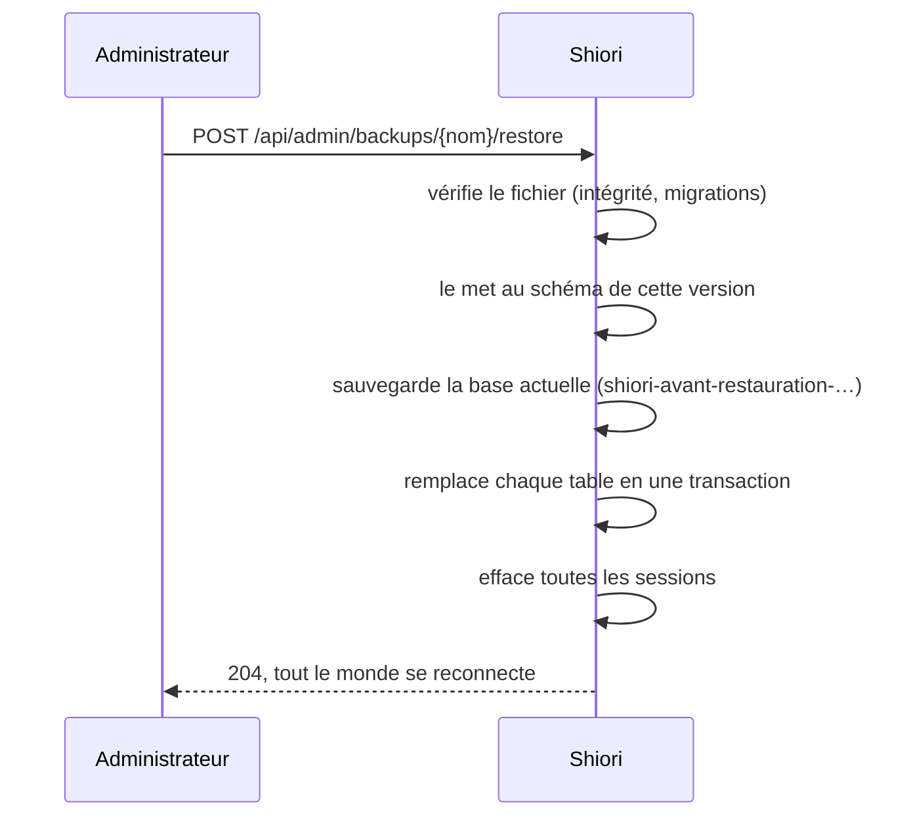

# Sauvegardes

Routes **admin** de **Administration → Données**.

### `GET /api/admin/storage`

Chemins complets sur le serveur.

```json
{ "database": "/data/shiori.db", "cache": "/cache" }
```

### `GET /api/admin/backups`

```json
{ "dir": "/data/backups", "every_hours": 24, "keep": 7, "files": [{ "name": "shiori-20261118-030000.db", "size": 5242880, "modified_ms": 1795143600000 }] }
```

`every_hours` : `null` sans sauvegarde périodique.

### `POST /api/admin/backups`

Une sauvegarde tout de suite (cohérente, Shiori allumé). **Réponse 201** : le fichier créé.

### `GET /api/admin/backups/{nom}`

Télécharge une sauvegarde.

### `DELETE /api/admin/backups/{nom}`

**Réponse 204**.

### `POST /api/admin/backups/upload`

Téléverse une sauvegarde récupérée ailleurs : le fichier SQLite en **corps brut** (pas de formulaire). L'en-tête SQLite est exigé. **Réponse 201** : le fichier rangé dans le dossier des sauvegardes. **Erreurs** : 400 `invalid_body`.

### `POST /api/admin/backups/{nom}/restore`

Remplace la base par cette sauvegarde, sans redémarrer.



**Erreurs** : 409 `scan_already_running` (attendre la fin du scan ou l'annuler), 422 `invalid_backup`, 422 `backup_too_new` (sauvegarde d'une version plus récente : mettre Shiori à jour d'abord).
