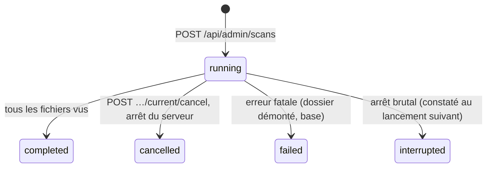

# Scans

Toutes ces routes sont **admin**. Une seule passe tourne à la fois, que la demande vienne de l'API, de la [surveillance des dossiers](/technical/backend#surveillance-des-dossiers) ou du scan complet périodique.



### `POST /api/admin/scans`

```json
{ "library_id": 1, "path": "/bibliotheques/mangas/One Piece", "deep": false, "rehash": false }
```

| Champ | |
|---|---|
| `library_id` | bibliothèque |
| `path` | facultatif : un dossier ou un fichier sous sa racine ; absent : toute la bibliothèque |
| `deep` | décode entièrement chaque image ; sur toute la bibliothèque, met à jour la date de vérification complète |
| `rehash` | relit même les fichiers inchangés (taille et date) |

**Réponse 202**

```json
{ "run": 41 }
```

**Erreurs** : 409 `scan_already_running`, 404 `not_found` (bibliothèque), 400 `path_outside_library` (hors de la racine, `..` ou lien symbolique), 404 `path_not_found`, 503 `shutting_down`.

### `GET /api/admin/scans/current`

La passe en cours, ou **204** si rien ne tourne.

```json
{ "run": 41, "library_id": 1, "target": "/bibliotheques/mangas", "total": 318, "done": 120, "current": "/bibliotheques/mangas/Blame!/Blame! v02.cbr", "counts": { "ok": 110, "warning": 8, "error": 2, "unchanged": 100, "removed": 0 }, "cancelling": false }
```

### `POST /api/admin/scans/current/cancel`

Arrête la passe après les fichiers déjà commencés. **Réponse 202** `{ "cancelling": true }`. **Erreurs** : 404 `no_scan_running`.

### `GET /api/admin/scans`

Historique, du plus récent au plus ancien. Paramètres : `status` (`running`, `completed`, `cancelled`, `failed`, `interrupted`), `library_id`, `before` (numéro de passe, pagination), `limit`.

```json
[{
  "id": 41, "library_id": 1, "origin": "api", "status": "completed", "root": "/bibliotheques/mangas",
  "options": { "deep": false, "rehash": false, "trigger": "watch" },
  "started_at": "…", "finished_at": "…", "duration_ms": 12480, "files_total": 318,
  "counts": { "ok": 300, "warning": 16, "error": 2, "unchanged": 290, "removed": 1 }, "error": null
}]
```

`origin` : `cli` ou `api` ; `options.trigger` : `manual`, `watch` (surveillance), `schedule` (scan complet périodique) ; `counts.unchanged` est compris dans les autres compteurs.

### `GET /api/admin/scans/{id}`

Une passe, même forme.

### `GET /api/admin/scans/{id}/logs`

Journal d'une passe dans l'ordre. Paramètres : `level` (gravité minimale : `info`, `warning`, `error`), `after` (numéro de ligne, pagination), `limit`.

```json
[{ "id": 3, "at": "…", "level": "error", "path": "/bibliotheques/mangas/B.cbz", "code": "no_pages", "message": "…", "series_id": 9, "volume_id": "c0d1…" }]
```

`series_id`, `volume_id` : ce que ce chemin est aujourd'hui ; `null` si le fichier n'est plus suivi.
