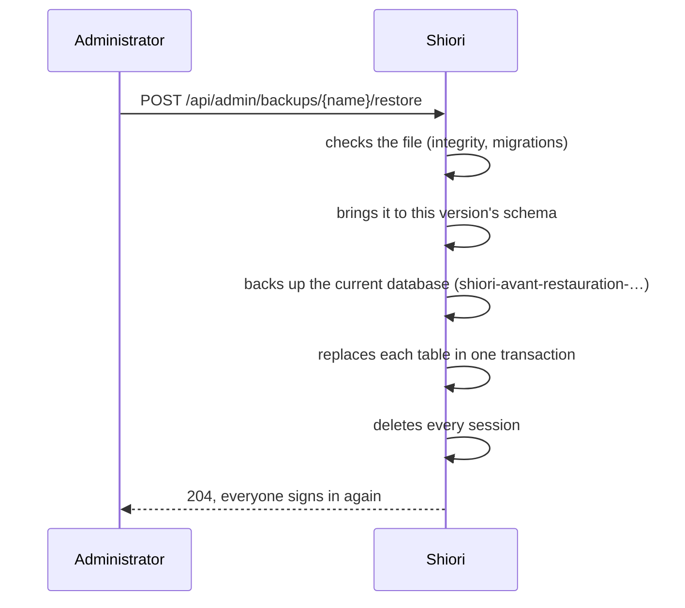

# Backups

**Admin** routes of **Administration → Data**.

### `GET /api/admin/storage`

Full paths on the server.

```json
{ "database": "/data/shiori.db", "cache": "/cache" }
```

### `GET /api/admin/backups`

```json
{ "dir": "/data/backups", "every_hours": 24, "keep": 7, "files": [{ "name": "shiori-20261118-030000.db", "size": 5242880, "modified_ms": 1795143600000 }] }
```

`every_hours`: `null` without periodic backups.

### `POST /api/admin/backups`

A backup right away (consistent, Shiori running). **Response 201**: the file created.

### `GET /api/admin/backups/{name}`

Downloads a backup.

### `DELETE /api/admin/backups/{name}`

**Response 204**.

### `POST /api/admin/backups/upload`

Uploads a backup recovered elsewhere: the SQLite file as a **raw body** (not a form). The SQLite header is required. **Response 201**: the file stored in the backup folder. **Errors**: 400 `invalid_body`.

### `POST /api/admin/backups/{name}/restore`

Replaces the database with this backup, without restarting.



**Errors**: 409 `scan_already_running` (wait for the scan to end or cancel it), 422 `invalid_backup`, 422 `backup_too_new` (backup from a newer version: update Shiori first).
