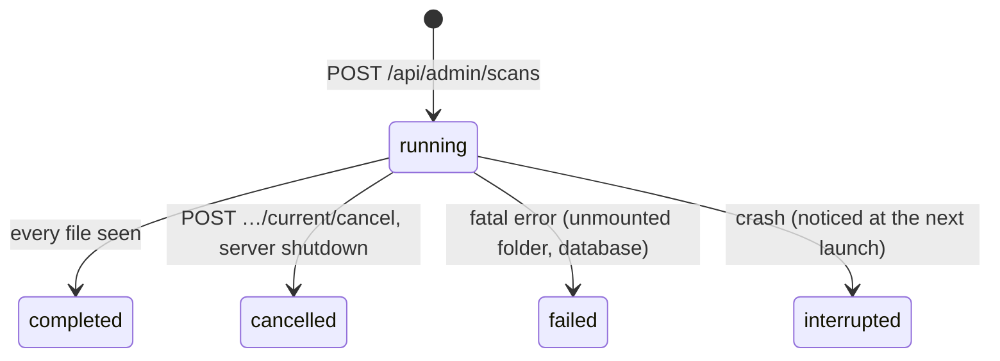

# Scans

All these routes are **admin**. Only one pass runs at a time, whether the request comes from the API, [folder watching](/en/technical/backend#folder-watching) or the periodic full scan.



### `POST /api/admin/scans`

```json
{ "library_id": 1, "path": "/libraries/manga/One Piece", "deep": false, "rehash": false }
```

| Field | |
|---|---|
| `library_id` | library |
| `path` | optional: a folder or file under its root; missing: the whole library |
| `deep` | fully decodes every image; on the whole library, updates the full check date |
| `rehash` | reads even unchanged files (size and date) |

**Response 202**

```json
{ "run": 41 }
```

**Errors**: 409 `scan_already_running`, 404 `not_found` (library), 400 `path_outside_library` (outside the root, `..` or symbolic link), 404 `path_not_found`, 503 `shutting_down`.

### `GET /api/admin/scans/current`

The current pass, or **204** if nothing runs.

```json
{ "run": 41, "library_id": 1, "target": "/libraries/manga", "total": 318, "done": 120, "current": "/libraries/manga/Blame!/Blame! v02.cbr", "counts": { "ok": 110, "warning": 8, "error": 2, "unchanged": 100, "removed": 0 }, "cancelling": false }
```

### `POST /api/admin/scans/current/cancel`

Stops the pass after the files already started. **Response 202** `{ "cancelling": true }`. **Errors**: 404 `no_scan_running`.

### `GET /api/admin/scans`

History, most recent first. Parameters: `status` (`running`, `completed`, `cancelled`, `failed`, `interrupted`), `library_id`, `before` (pass number, pagination), `limit`.

```json
[{
  "id": 41, "library_id": 1, "origin": "api", "status": "completed", "root": "/libraries/manga",
  "options": { "deep": false, "rehash": false, "trigger": "watch" },
  "started_at": "…", "finished_at": "…", "duration_ms": 12480, "files_total": 318,
  "counts": { "ok": 300, "warning": 16, "error": 2, "unchanged": 290, "removed": 1 }, "error": null
}]
```

`origin`: `cli` or `api`; `options.trigger`: `manual`, `watch` (watching), `schedule` (periodic full scan); `counts.unchanged` is included in the other counters.

### `GET /api/admin/scans/{id}`

One pass, same shape.

### `GET /api/admin/scans/{id}/logs`

A pass's log in order. Parameters: `level` (minimum severity: `info`, `warning`, `error`), `after` (line number, pagination), `limit`.

```json
[{ "id": 3, "at": "…", "level": "error", "path": "/libraries/manga/B.cbz", "code": "no_pages", "message": "…", "series_id": 9, "volume_id": "c0d1…" }]
```

`series_id`, `volume_id`: what this path is today; `null` if the file is no longer tracked.
