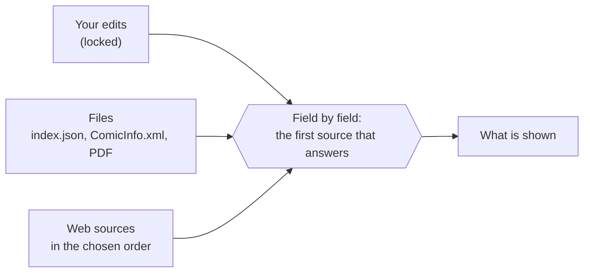

# Metadata

A series' information (title, alternative titles, summary, authors, genres, tags, year, publisher, publication status, cover, links) comes from three sources. The first one that answers wins, **field by field**:

1. **your edits** (the **Edit** button on the series page): an edited field is locked, and neither a rescan nor a web source replaces it; "Restore" hands it back to the sources;
2. **your files**: `ComicInfo.xml` and `index.json` in the archives, and for a PDF its properties (author, subject, keywords; its title and date are ignored, they are often those of the conversion tool), read when scanning; a January 1970 date is ignored too (a creation tool's blank date, badly converted);
3. **web sources**, if you allow them: AniList, MangaDex, Wikipedia and MangaUpdates.

The **displayed title** is the edited title, otherwise the files' one (`ComicInfo.xml`, `index.json`), otherwise the series name taken from your file and folder names. Web sources' titles are not used for it: a Japanese title in romaji or a word-for-word translation is not the title of your edition. They stay alternative titles, which search finds. One exception: an all-lowercase name (`one-piece`) takes the spelling of an entry with the same name ("One Piece").

A volume also has its own metadata (title, summary, date, authors), editable from its menu.

## Web sources

They are **off by default** (**Administration → Web metadata**). Only the series title is sent, with a generic client name; never a path, a file name or a user name. Once allowed:

- after each scan, a series is linked on its own if a single result has exactly its title; otherwise it is "to check";
- **Identify** (series page) shows each linked source first (refresh, use its cover, unlink), then searches a source and offers the results with their cover;
- an **unlinked** source stays unlinked: automatic identification no longer links it; to link it again, choose an entry in **Identify**;
- the order of the sources is set in the administration (by default, MangaDex first in French, AniList first in English, then Wikipedia and MangaUpdates), and a series can impose its main source;
- **Wikipedia** is a fallback source: the article is searched on the Wikipedia of the interface language, and the linked entry keeps the introduction in French and in English, with the link to each article; it only brings the summary and the link (no title, genres, tags or cover). Texts under the CC BY-SA license;
- **MangaUpdates** brings titles (including associated titles, useful for matching), an English summary, authors, genres, year, status, cover and link; it needs no key. A series already in the database is searched there at the next identification;
- **language comes before source**: the title and summary in the interface language are looked for in every linked source before English; for the same language, the main source, then the set order, decide;
- genres and tags from the sources (in English there) are shown translated into the interface language; search and the "Tags" filter find them in both languages;
- adult entries are excluded from searches, unless the administration allows them.

## Cover

A series' cover is the first page of its first volume, or the one you choose: any page, or a source's cover (kept by the server). Without a cover, Shiori draws one with the title and the author.

A volume has its own cover too: its first page, or the one chosen in the reader (**Display** panel, "Use as volume cover"). A volume's menu (**⋮** on its cover, series page) offers **Edit** to the administrator: its title, and "Restore" to hand the title or the cover back to the files. The number comes from the file name: renaming the file changes it at the next scan.
