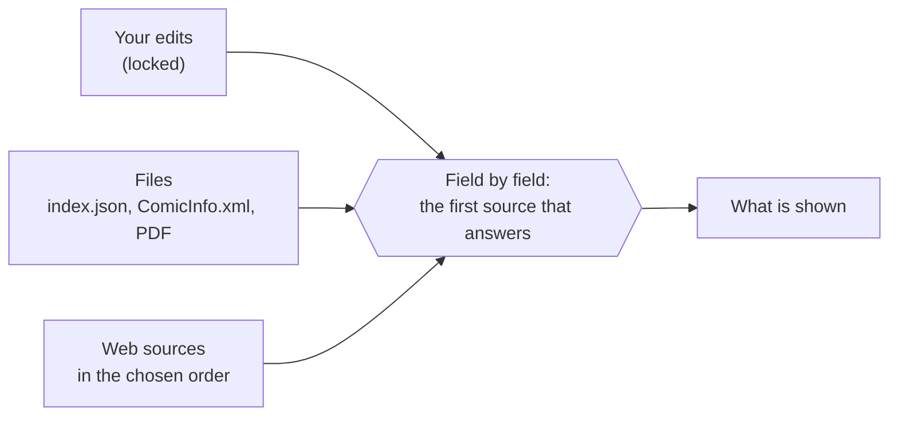

# Metadata

A series' information (title, alternative titles, summary, authors, genres, tags, year, publisher, publication status, cover, links) comes from three sources. The first one that answers wins, **field by field**:

1. **your edits** (the **Edit** button on the series page): an edited field is locked, and neither a rescan nor a web source replaces it; "Restore" hands it back to the sources;
2. **your files**: `ComicInfo.xml` and `index.json` in the archives, and for a PDF its properties (author, subject, keywords; its title and date are ignored, they are often those of the conversion tool), read when scanning;
3. **web sources**, if you allow them: AniList and MangaDex.

The **displayed title** is the edited title, otherwise the files' one, otherwise the web sources' one (in the interface language, or in romaji), otherwise the folder name. The other titles stay searchable.

A volume also has its own metadata (title, summary, date, authors), editable from its menu.

## Web sources

They are **off by default** (**Administration → Web metadata**). Only the series title is sent, with a generic client name; never a path, a file name or a user name. Once allowed:

- after each scan, a series is linked on its own if a single result has exactly its title; otherwise it is "to check";
- **Identify** (series page) searches a source and offers the results with their cover;
- the order of the sources is set in the administration (by default, MangaDex first in French, AniList first in English), and a series can impose its main source;
- adult entries are excluded from searches, unless the administration allows them.

<!-- [ecran_identifier] -->

## Cover

A series' cover is the first page of its first volume, or the one you choose: any page, or a source's cover (kept by the server). Without a cover, Shiori draws one with the title and the author.
