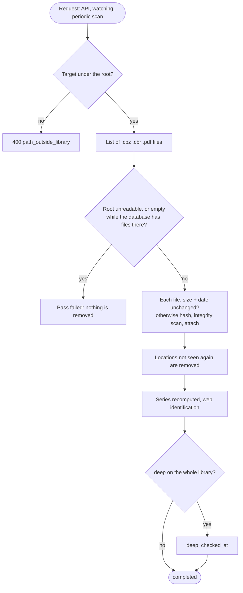
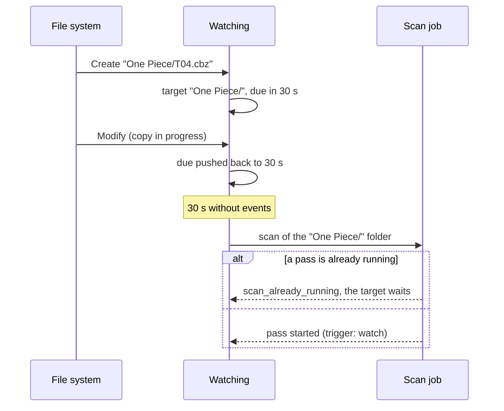
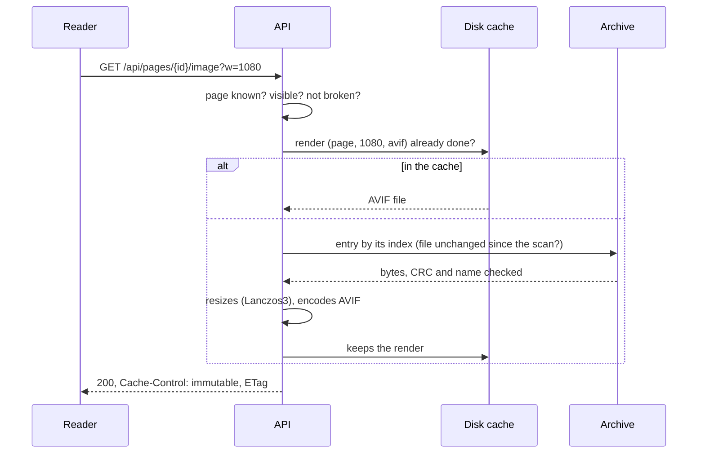

# Backend

## Server

- **axum** + **tokio**, hyper accept loop with a 10 s limit to receive headers (a slow client does not keep its connection), brotli / gzip compression of text responses, `tracing` logs (`-v`, `-vv`, or `RUST_LOG`).
- **Shared state** (`App`): the database, the image cache, the scan job, web metadata, backups, a render semaphore (4 at most) and the authentication guard.
- **Clean shutdown** on Ctrl-C and SIGTERM (`docker stop`): no pass starts anymore, the current scan is cancelled and its pass closed.
- **Front end**: everything outside `/api` is the web app, a file from `web/dist`, or `index.html` for an app route (React Router). In debug, `web/dist` is read from disk; in release, it is embedded in the binary (`rust-embed`): `npm run build` before `cargo build --release`.
- **Folders**: data and cache in the OS folders (`directories` crate), or `SHIORI_DATA_DIR`, `SHIORI_CACHE_DIR`, `--db`, `--cache-dir`.

## Scan job

`job.rs`: one pass at a time, on a library, a folder or a file under its root (no `..` nor symbolic link). Same engine as the CLI (`Db::scan`), files scanned in parallel (`--jobs`), progress in memory, cancellation between two files. A pass interrupted by a crash is closed (`interrupted`) at the next launch.

End of a folder pass: locations not seen again are removed, with safeguards:

- unreadable folder: the pass fails without removing anything;
- empty root while the database knows files in it (unmounted disk): the pass fails without removing anything;
- unreadable subfolder (`lost+found`): its volumes are kept as they are, with a warning.

Then series are recomputed (a renamed folder keeps its identity: the series is found again by the hash of its volumes), web identification starts if enabled, and a `deep` pass completed on the whole library records the full check date.

## Folder watching

`watch.rs`, `notify` crate: one recursive watcher per watched library.

- A change targets the **series folder** (first level under the root); what is added, renamed or removed directly under the root, or a series folder that vanished, targets the root (a series rename is only recognized when one pass sees both names).
- **Quiet time** of 30 s per folder: a file being copied restarts the wait. Targets wait in the watcher (one per folder) and leave one by one when no pass runs; a root pass covers the pending folders of its library.
- **Ignored**: accesses and metadata (the scan and the reader read files; otherwise one scan would start another), changes to a folder itself (Windows reports it on top of the entry's), and what Shiori writes itself (database, cache, backups stored inside a library), under their path and their real path (macOS reports `/private/var` for `/var`).
- **Catch-up**: a root that becomes watched (startup, watching turned back on, disk mounted later) is scanned right away, except a library that was just created, whose scan the interface already starts.
- **Safety net**: full scan of all libraries every `full_scan_hours` hours; event queue overflow → rescan of the roots; root that cannot be watched → new attempt every 5 minutes.
- Passes record their origin (`trigger`: `manual`, `watch`, `schedule`).

## Images

- **Fixed widths** (`render.rs`, `WIDTHS`: 160, 320, 480, 640, 800, 1080, 1280, 1600, 2048 px): the client asks for the smallest one that covers its displayed width in real pixels; a closed list bounds the cache and prevents computing thousands of variants. Never upscaled: a narrower page is served as is.
- **Formats**: AVIF for pages (`ravif`, quality 70), JPEG for thumbnails and covers (quality 85), Lanczos3 resizing, memory-capped decoding; all in pure Rust. A page already in AVIF is served as is.
- **Disk cache** (`cache.rs`) keyed by (page, width, format, render version); nothing is ever invalidated, the least recently read goes when the cap (`--cache-max-mib`, 2 GiB) is reached. At most 4 renders at once.
- **Rendering ahead**: each page requested by the reader (in AVIF; not a JPEG cover) has the next 5 readable pages of the volume prepared in the background, at the same width and format, one at a time; only if a render slot stays free for real requests, and a real request waits for a render already in progress instead of doing it again. Each render's time is logged (`RUST_LOG=shiori=debug`, message "page rendue"). Measured on a Celeron N5105 NAS: a 1,080 px AVIF page in about 1 s alone, 2 s when 4 renders run together (about 2 pages per second); a JPEG thumbnail in 0.15 s.
- **Webtoon**: strips are served in their original size as long as they do not exceed three times the useful width.

## Metadata

**Field-by-field** merging (`shiori-db::metadata`): edited field (locked) > files (`index.json`, then `ComicInfo.xml`, then a PDF's `Info`) > web sources in the chosen order. A series' merged view is recomputed and stored on each change, once per interface language, each account reading the one of its language.

Web sources (`shiori-meta`, off by default): AniList (GraphQL), MangaDex (REST), Wikipedia (Action API, summary and link only) and MangaUpdates (REST, one request per second, the matched entry read in full: its search results have neither authors nor status), called outside the async runtime, serially, rate below published limits, `Retry-After` and `maxlag` honored, generic client name (for Wikipedia, which requires a contact: the repository address, never anything about the user), only the series title sent. Automatic identification after each scan: a link only if a single candidate has exactly the same normalized title. Covers downloaded only from each source's known hosts, without following redirects (SSRF protection), 4,096 px per side at most.

## Backups

`VACUUM INTO` (consistent copy, Shiori running) into a hidden temporary file, renamed once complete, 0600 permissions on Unix, named `<prefix>-YYYYMMDD-HHMMSS.db`. An existing database about to be migrated is copied first (`shiori-avant-<migration>-…`). **Restore** while running: checked working copy (`integrity_check`, `_sqlx_migrations` table present), migrated to the current schema (a newer version is refused), schemas compared, then each table emptied and refilled in one transaction; sessions are deleted.
