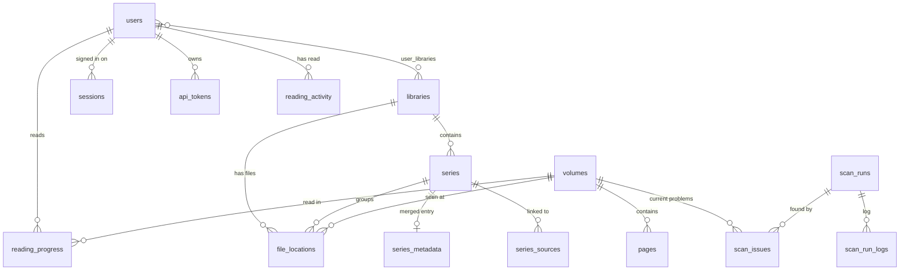

# Database

SQLite (`sqlx`, `sqlite-bundled`), one `shiori.db` file in WAL mode, migrations applied at launch (`backend/crates/shiori-db/migrations/`, one per batch that needs it). An existing database is backed up before each migration.

## Tables

| Table | Content |
|---|---|
| `volumes` | one volume per content: hash, size, format, status, page count, scan version, date |
| `pages` | one row per page: `page_id`, volume, entry name (decoded and raw), `ordinal`, index in the archive, type, width, height, CRC, status |
| `file_locations` | where each volume is: path, size, date, library, series, name parser result, last pass that saw it |
| `libraries` | libraries: name, root, type, watching (`watch`), date of the last full check (`deep_checked_at`) |
| `series` | series: library, folder, name, publication status, date added |
| `scan_runs`, `scan_issues`, `scan_run_logs` | scan passes (status, options, counters), current problems of each volume (or of an unreadable file), log of each pass (kept `--scan-log-days`) |
| `users`, `sessions`, `user_libraries` | accounts (Argon2id, role), sessions (BLAKE3 hash of the token, 90 days sliding), libraries open to a reader |
| `user_totp`, `user_recovery_codes` | an account's TOTP secret (last accepted step), recovery codes (BLAKE3 hash, single use) |
| `api_tokens` | API tokens (`shiori_t_` + 256 bits, only the BLAKE3 hash kept, prefix, optional expiry) |
| `reading_progress` | page read per account and per volume |
| `reading_activity` | pages, time and finished volumes per account and per day (statistics) |
| `user_series_settings`, `user_settings` | reading settings of a series and preferences (language, theme, page turn), per account |
| `legacy_progress`, `legacy_series_settings` | progress and settings from before accounts, taken over by the first administrator |
| `app_settings` | instance settings: default language, theme and page turn, web metadata, full scan interval (`full_scan_hours`) |
| `volume_metadata`, `volume_edits` | file metadata per volume, and fields edited by hand |
| `series_metadata` | a series' edited fields and merged view, in French (`merged`) and English (`merged_en`) |
| `series_sources` | linked or candidate web entries per series and per source |
| `covers` | chosen source covers (BLAKE3 of the content); purged at startup when no series references them anymore |

## Simplified schema

## Rules

- What depends on the path lives on the **location** (`file_locations`), not on the volume: the same volume can be seen in several places. Deleting a library deletes its locations and series, never volumes or pages (progress stays).
- `scan_issues` is the **current state**: the problems of each volume's last scan. A file without a reliable volume (unreadable) has rows without `volume_id`, cleaned up when it disappears.
- A pass that the current problems of a volume come from is not purged.
- Dates are RFC 3339 UTC (`strftime('%Y-%m-%dT%H:%M:%fZ')`).
