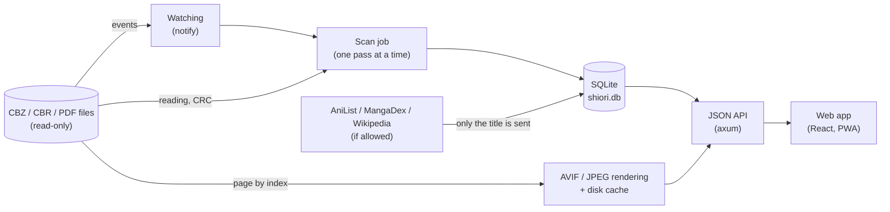

# Overview

How Shiori is built, for whoever wants to maintain it or contribute. Decisions and their history are in [ROADMAP.md](https://github.com/befa160/shiori/blob/main/ROADMAP.md), working rules in [CLAUDE.md](https://github.com/befa160/shiori/blob/main/CLAUDE.md), the interface in [DESIGN_SYSTEM.md](https://github.com/befa160/shiori/blob/main/DESIGN_SYSTEM.md) (in French).

## A single binary

The `shiori` Rust binary has four commands:

- `shiori serve` (or `shiori` without arguments): HTTP server that serves the JSON API under `/api` and the web app (React) embedded in the binary;
- `shiori scan <paths>`: command-line integrity scan, with or without a database;
- `shiori user …`: accounts, without going through the server;
- `shiori backup`: database backup.

The scan is the only source of truth about pages: the API and the reader only read back what it established.



## Principles and invariants

- **Volume identity**: BLAKE3 of the file's full content (`VolumeId`, `shiori-core/src/id.rs`). Renaming or moving changes nothing; changing the content creates a new volume. Full hash on the first pass, then size + modification date to detect a change (`--rehash` forces a reread).
- **Page identity**: `BLAKE3(volume_id ‖ 0x00 ‖ raw entry name)`, truncated to 128 bits (`PageId`), on the raw bytes of the name in the archive (no CP437 / UTF-8 decoding can change an identifier). Both formulas are frozen by `*_is_frozen` tests: changing them would invalidate every address and every progress.
- **Page order**: natural sort of entry names (`alphanumeric-sort`), stored as `ordinal`; on equal values, `9` comes before `09`. The order in the archive never counts: the reader gets the ordered list of `page_id`s, and the server reads each page by the index recorded for that identifier (end-to-end "reading invariant" test).
- **Immutable image addresses**: `/api/pages/{page_id}/image` answers with `Cache-Control: immutable` and an ETag; a page never changes under the same identifier, so no cache (browser, service worker, disk) ever needs invalidating.
- **Visible error**: a missing or unreadable page returns a JSON error with a stable code; the interface shows that error in place of the page, never another image. The service worker only keeps 200 responses.
- **Source files**: opened read-only, never modified nor fully extracted (except the bounded cache of solid RARs).
- **Portability**: pure Rust as much as possible (embedded SQLite, `ring` for TLS), no external command, separator-independent paths; CI on Linux, Windows and macOS.

## The repository

```
backend/                   cargo workspace (stable toolchain, rust-toolchain.toml)
  crates/shiori-core/      archives (CBZ, CBR, PDF), identities, name parser, integrity scan,
                           ComicInfo / index.json / PDF Info (no database, no async)
  crates/shiori-db/        SQLite database (sqlx): scans, libraries, series, progress, accounts,
                           settings, metadata and merging, health; migrations in migrations/
  crates/shiori-meta/      AniList, MangaDex and Wikipedia clients (ureq + rustls), rate-limited
  crates/shiori-testkit/   fixtures generated by code (archives, images, tricky cases)
  crates/shiori/           the binary: CLI, axum server, scan job, folder watching,
                           image rendering, disk cache, web metadata, embedded front end
web/                       React 19 + TypeScript + Vite + Tailwind + shadcn/ui
  src/api/                 API client and types, TanStack Query requests
  src/reader/              reader (pages, double pages, virtualized webtoon, gestures, progress)
  src/library/ src/browse/ home, grids, series page, editing, identification
  src/admin/               libraries, health, scans and logs, accounts, metadata, data
  src/offline/             downloaded volumes and offline progress
  src/i18n/                fr.ts (source) and en.ts (typed on the French one) catalogs
  public/sw.js             service worker
  e2e/                     Playwright tests against a real `shiori serve`
docs/                      this documentation (VitePress)
```

## Dependency choices

| Need | Choice | Why |
|---|---|---|
| HTTP server | axum, tokio, tower-http | de facto Rust standard, light, built-in compression |
| Database | SQLite via sqlx (`sqlite-bundled`) | one file, nothing to install, checked queries, migrations |
| ZIP | zip | zip64, direct access through the central directory |
| RAR | rars | pure Rust, RAR 4 and 5, solid included (never `unrar`, non-free) |
| PDF | hayro-interpret (`embed-fonts`) | pure Rust, lazy parsing, JPEG 2000, JBIG2, CCITT decoders included |
| Hash | blake3 (`pure`) | fast, no C code |
| Images | image, ravif, imagesize | AVIF / JPEG decoding and encoding in pure Rust, dimensions without decoding |
| Watching | notify | inotify, ReadDirectoryChangesW, FSEvents behind one API |
| Outgoing HTTP | ureq + rustls (`ring`) | simple synchronous client, TLS without OpenSSL |
| Passwords, TOTP | argon2, totp-rs, qrcode | pure Rust, SVG QR without images |
| Embedded front end | rust-embed | a single binary |
| Interface | React, Tailwind, shadcn/ui, TanStack Query | accessible components (Radix), simple server state |
| Documentation | VitePress | Markdown, local search, two languages |
