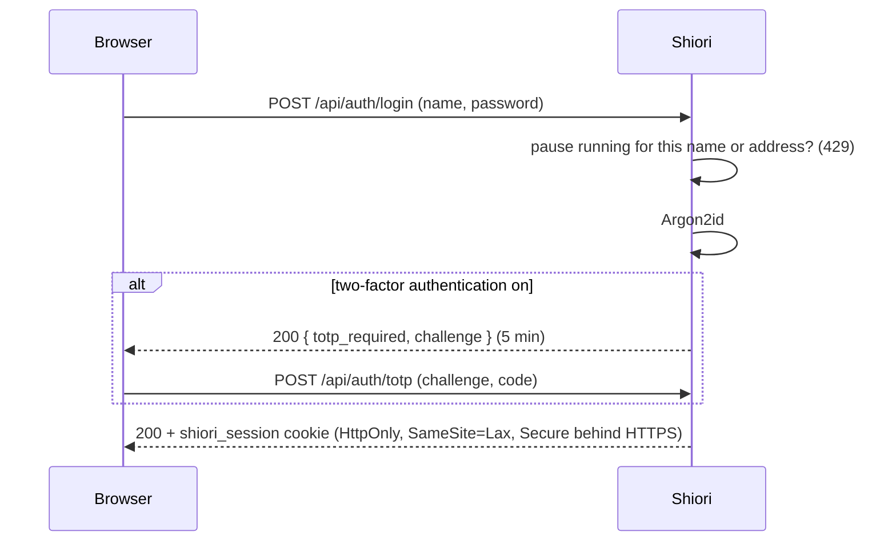

# Security

## Authentication

- **Sessions**: random 256-bit token, only its BLAKE3 hash is kept; `shiori_session` cookie `HttpOnly`, `SameSite=Lax`, `Secure` when the proxy announces `X-Forwarded-Proto: https`; 90 days sliding. A native app can ask for the token in the response (`client: "app"`) and send it as `Authorization: Bearer`.
- **Passwords**: Argon2id, 8 characters at least, capped length (a multi-MB password does not make Argon2 work for nothing).
- **Failed attempts** counted per name (5 free) and per address (20 free), then a pause that doubles up to 15 minutes (429 `rate_limited`, `Retry-After`) without computing the hash. The address is the connection's, or the last `X-Forwarded-For` when the connection comes from a local proxy (loopback or private network).
- **Setup**: while no account exists, the first administrator is created with a token drawn at random at each start and printed in the console (even with `--quiet`).
- **Two-factor authentication**: TOTP (`totp-rs`) SHA-1, 6 digits, 30 s, one step of tolerance, a code works only once; 5-minute challenge between the password and the code; 10 recovery codes (BLAKE3 hash, single use).
- **API tokens**: `shiori_t_` + 256 bits, only the hash is kept, optional expiry; they only open reading and progress (403 `token_forbidden` elsewhere).
- **Temporary password**: until it is changed, only `/api/me` and `/api/me/password` answer.

## Authorization

A reader only sees the libraries open to them (404 for the rest, without saying they exist); administration routes answer 403 `forbidden`. The last active administrator can be neither demoted, nor disabled, nor deleted.

## Protections

- **DNS rebinding**: when listening locally, only a local `Host` is accepted; `--allowed-host` / `SHIORI_ALLOWED_HOSTS` adds names and enables this check when listening on the network (the Docker image does it for `localhost`). Otherwise: 403 `invalid_host`.
- **CSRF**: writes refused if `Sec-Fetch-Site: cross-site` (403 `cross_site`), on top of the `SameSite=Lax` cookie.
- **Paths**: a scan only targets a path under a library root, without `..` or symbolic link (`path_outside_library`).
- **Hostile archives**: declared sizes checked, caps on entries, pixels and memory, decoder panics isolated per file.
- **SSRF**: source covers downloaded only from their known hosts, without following redirects.
- **Slowness**: 10 s to receive a request's headers.
- **Privacy**: web sources only receive a series' title, with a generic client name.

## Reporting a vulnerability

Open a [private security advisory](https://github.com/befa160/shiori/security/advisories/new) on GitHub rather than a public issue.
