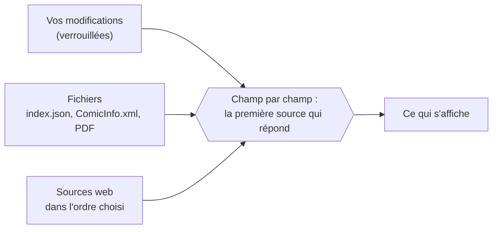

# Métadonnées

Les informations d'une série (titre, titres alternatifs, résumé, auteurs, genres, tags, année, éditeur, statut de publication, couverture, liens) viennent de trois sources. La première qui répond l'emporte, **champ par champ** :

1. **vos modifications** (bouton **Modifier** de la page série) : un champ modifié est verrouillé, et ni un rescan ni une source web ne le remplacent ; « Rétablir » le rend aux sources ;
2. **vos fichiers** : `ComicInfo.xml` et `index.json` dans les archives, et pour un PDF ses propriétés (auteur, sujet, mots-clés ; son titre et sa date sont ignorés, ce sont souvent ceux de l'outil de conversion), lus au scan ; une date de janvier 1970 est aussi ignorée (la date vide d'un outil de création mal convertie) ;
3. **les sources web**, si vous les autorisez : AniList, MangaDex et Wikipédia.

Le **titre affiché** est le titre modifié, sinon celui des fichiers (`ComicInfo.xml`, `index.json`), sinon le nom de la série tiré de vos noms de fichiers et de dossiers. Les titres des sources web n'y passent pas : un titre japonais en romaji ou une traduction mot à mot n'est pas le titre français. Ils restent des titres alternatifs, que la recherche trouve. Seule exception : un nom tout en minuscules (`one-piece`) prend l'écriture d'une fiche qui porte le même nom (« One Piece »).

Un tome a aussi ses métadonnées (titre, résumé, date, auteurs), modifiables depuis son menu.

## Sources web

Elles sont **désactivées par défaut** (**Administration → Métadonnées web**). Seul le titre de la série part, avec un nom de client générique ; jamais un chemin, un nom de fichier ou un nom d'utilisateur. Une fois autorisées :

- après chaque scan, une série est liée toute seule si un seul résultat porte exactement son titre ; sinon elle est « à vérifier » ;
- **Identifier** (page série) montre en tête chaque source liée (actualiser, prendre sa couverture, délier), puis cherche dans une source et propose les résultats avec leur couverture ;
- une source **déliée** le reste : l'identification automatique ne la relie plus ; pour la relier, choisissez une fiche dans **Identifier** ;
- l'ordre des sources se règle dans l'administration (par défaut, MangaDex d'abord en français, AniList d'abord en anglais, Wikipédia en dernier), et une série peut imposer sa source principale ;
- **Wikipédia** est une source de repli : l'article est cherché sur le Wikipédia de la langue de l'interface, et la fiche liée garde l'introduction en français et en anglais, avec le lien vers chaque article ; elle n'apporte que le résumé et le lien (ni titre, ni genres, ni tags, ni couverture). Textes sous licence CC BY-SA ;
- **la langue passe avant la source** : le titre et le résumé dans la langue de l'interface sont cherchés dans toutes les sources liées avant l'anglais ; à langue égale, la source principale, puis l'ordre réglé, départagent ;
- les genres et tags des sources (en anglais chez elles) s'affichent traduits dans la langue de l'interface ; la recherche et le filtre « Tags » les trouvent dans les deux langues ;
- les fiches pour adultes sont exclues des recherches, sauf si l'administration les permet.

## Couverture

La couverture d'une série est la première page de son premier tome, ou celle que vous choisissez : n'importe quelle page, ou la couverture d'une source (gardée par le serveur). Sans couverture, Shiori en dessine une avec le titre et l'auteur.

Un tome a aussi sa couverture : sa première page, ou celle choisie dans le lecteur (panneau **Affichage**, « Utiliser comme couverture du tome »). Le menu d'un tome (**⋮** sur sa couverture, page série) propose **Modifier** à l'administrateur : son titre, et « Rétablir » pour rendre le titre ou la couverture aux fichiers. Le numéro vient du nom du fichier : renommer le fichier le change au prochain scan.
