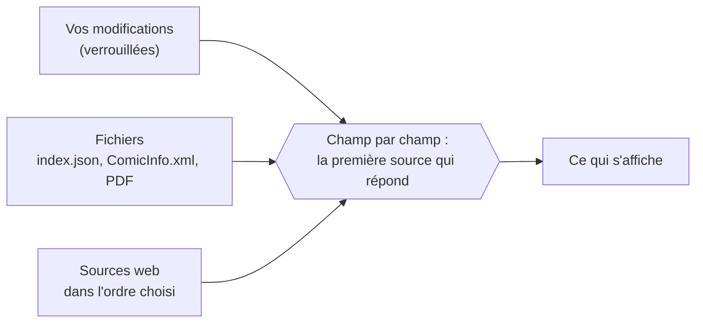

# Métadonnées

Les informations d'une série (titre, titres alternatifs, résumé, auteurs, genres, tags, année, éditeur, statut de publication, couverture, liens) viennent de trois sources. La première qui répond l'emporte, **champ par champ** :

1. **vos modifications** (bouton **Modifier** de la page série) : un champ modifié est verrouillé, et ni un rescan ni une source web ne le remplacent ; « Rétablir » le rend aux sources ;
2. **vos fichiers** : `ComicInfo.xml` et `index.json` dans les archives, et pour un PDF ses propriétés (auteur, sujet, mots-clés ; son titre et sa date sont ignorés, ce sont souvent ceux de l'outil de conversion), lus au scan ; une date de janvier 1970 est aussi ignorée (la date vide d'un outil de création mal convertie) ;
3. **les sources web**, si vous les autorisez : AniList, MangaDex, Wikipédia, MangaUpdates et Comic Vine.

Le **titre affiché** est le titre modifié, sinon celui des fichiers (`ComicInfo.xml`, `index.json`), sinon le nom de la série tiré de vos noms de fichiers et de dossiers. Les titres des sources web n'y passent pas : un titre japonais en romaji ou une traduction mot à mot n'est pas le titre français. Ils restent des titres alternatifs, que la recherche trouve. Seule exception : un nom tout en minuscules (`one-piece`) prend l'écriture d'une fiche qui porte le même nom (« One Piece »).

Un tome a aussi ses métadonnées (titre, résumé, date, auteurs), modifiables depuis son menu.

## Sources web

Elles sont **désactivées par défaut** (**Administration → Métadonnées web**). Seul le titre de la série part, avec un nom de client générique ; jamais un chemin, un nom de fichier ou un nom d'utilisateur. Une fois autorisées :

- après chaque scan, une série est liée toute seule si un seul résultat porte exactement son titre ; sinon elle est « à vérifier » ;
- **Identifier** (page série) montre en tête chaque source liée (actualiser, prendre sa couverture, délier), puis cherche dans une source et propose les résultats avec leur couverture ;
- une source **déliée** le reste : l'identification automatique ne la relie plus ; pour la relier, choisissez une fiche dans **Identifier** ;
- l'ordre des sources se règle dans l'administration (par défaut, MangaDex d'abord en français, AniList d'abord en anglais, puis Wikipédia, MangaUpdates et Comic Vine), et une série peut imposer sa source principale ;
- **Wikipédia** est une source de repli : l'article est cherché sur le Wikipédia de la langue de l'interface, et la fiche liée garde l'introduction en français et en anglais, avec le lien vers chaque article ; elle n'apporte que le résumé et le lien (ni titre, ni genres, ni tags, ni couverture). Textes sous licence CC BY-SA ;
- **MangaUpdates** apporte titres (dont les titres associés, utiles au rapprochement), résumé en anglais, auteurs, genres, année, statut, couverture et lien ; elle ne demande pas de clé. Une série déjà en base y est cherchée à la prochaine identification ;
- **Comic Vine** (comics et BD) apporte titres et alias, résumé en anglais, année, couverture et lien. Elle demande une **clé d'API personnelle et gratuite** (usage non commercial) : créez-la sur [comicvine.gamespot.com/api](https://comicvine.gamespot.com/api/), puis collez-la dans **Administration → Métadonnées web**. La clé reste sur le serveur (elle est dans les sauvegardes de la base) et n'est jamais réaffichée ; « Effacer la clé » la retire. Comic Vine limite chaque clé à 200 requêtes par heure : elle sert **seulement à la demande**, dans la fenêtre Identifier, jamais à l'identification automatique ;
- **la langue passe avant la source** : le titre et le résumé dans la langue de l'interface sont cherchés dans toutes les sources liées avant l'anglais ; à langue égale, la source principale, puis l'ordre réglé, départagent ;
- les genres et tags des sources (en anglais chez elles) s'affichent traduits dans la langue de l'interface ; la recherche et le filtre « Tags » les trouvent dans les deux langues ;
- les fiches pour adultes sont exclues des recherches, sauf si l'administration les permet.

## Actualisation périodique

Une fiche liée est gardée telle quelle et relue à la demande (« Actualiser » dans la fenêtre Identifier). **Administration → Métadonnées web → Actualiser les fiches liées** peut aussi la relire toute seule : **Jamais** (par défaut), **Chaque semaine** ou **Chaque mois**. Chaque heure, Shiori relit au plus 100 fiches plus anciennes que ce délai, les plus vieilles d'abord, au débit de chaque source ; si une source demande d'attendre ou ne répond pas, il reprend à l'heure suivante. Une fiche introuvable garde ses données et signale l'erreur. Rien ne part si les métadonnées web sont désactivées.

## Séries incomplètes

Shiori compare le **nombre officiel de tomes** d'une série aux tomes que vous avez. Ce nombre vient, dans l'ordre habituel, de vos fichiers (`<Count>` d'un `ComicInfo.xml`, lu au scan du tome), puis des sources web qui le donnent (AniList, MangaDex, MangaUpdates ; ni Wikipédia ni Comic Vine) ; il se corrige dans **Modifier** (« Nombre de tomes »).

- La page de la série affiche les tomes présents sur le total (« 38 / 43 tomes ») et les numéros manquants, en plages (« Tomes manquants : 2, 6–8, 43 »). Un fichier « T03-05 » compte pour trois tomes ; un hors-série (numéro décimal) ou un chapitre ne remplace pas un tome.
- Une série rangée en chapitres, ou dont le nombre officiel est inconnu, ne se compare pas.
- Une série **terminée** à qui il manque des tomes est **incomplète** : le filtre « Incomplète (tomes manquants) » de la liste des séries les montre.
- Une fiche liée avant la 1.4 n'a pas encore le nombre de tomes : « Actualiser » (fenêtre Identifier) le récupère, ou l'actualisation périodique ci-dessous.

## Couverture

La couverture d'une série est la première page de son premier tome, ou celle que vous choisissez : n'importe quelle page, ou la couverture d'une source (gardée par le serveur). Sans couverture, Shiori en dessine une avec le titre et l'auteur.

Un tome a aussi sa couverture : sa première page, ou celle choisie dans le lecteur (panneau **Affichage**, « Utiliser comme couverture du tome »). Le menu d'un tome (**⋮** sur sa couverture, page série) propose **Modifier** à l'administrateur : son titre, et « Rétablir » pour rendre le titre ou la couverture aux fichiers. Le numéro vient du nom du fichier : renommer le fichier le change au prochain scan.
