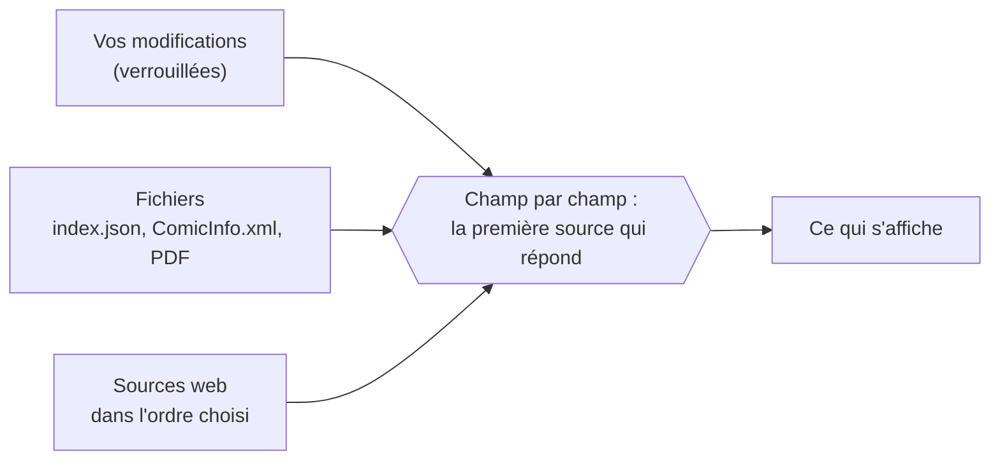

# Métadonnées

Les informations d'une série (titre, titres alternatifs, résumé, auteurs, genres, tags, année, éditeur, statut de publication, couverture, liens) viennent de trois sources. La première qui répond l'emporte, **champ par champ** :

1. **vos modifications** (bouton **Modifier** de la page série) : un champ modifié est verrouillé, et ni un rescan ni une source web ne le remplacent ; « Rétablir » le rend aux sources ;
2. **vos fichiers** : `ComicInfo.xml` et `index.json` dans les archives, et pour un PDF ses propriétés (auteur, sujet, mots-clés ; son titre et sa date sont ignorés, ce sont souvent ceux de l'outil de conversion), lus au scan ;
3. **les sources web**, si vous les autorisez : AniList et MangaDex.

Le **titre affiché** est le titre modifié, sinon celui des fichiers, sinon celui des sources web (dans la langue de l'interface, ou en romaji), sinon le nom du dossier. Les autres titres restent cherchables.

Un tome a aussi ses métadonnées (titre, résumé, date, auteurs), modifiables depuis son menu.

## Sources web

Elles sont **désactivées par défaut** (**Administration → Métadonnées web**). Seul le titre de la série part, avec un nom de client générique ; jamais un chemin, un nom de fichier ou un nom d'utilisateur. Une fois autorisées :

- après chaque scan, une série est liée toute seule si un seul résultat porte exactement son titre ; sinon elle est « à vérifier » ;
- **Identifier** (page série) cherche dans une source et propose les résultats avec leur couverture ;
- l'ordre des sources se règle dans l'administration (par défaut, MangaDex d'abord en français, AniList d'abord en anglais), et une série peut imposer sa source principale ;
- les fiches pour adultes sont exclues des recherches, sauf si l'administration les permet.

<!-- [ecran_identifier] -->

## Couverture

La couverture d'une série est la première page de son premier tome, ou celle que vous choisissez : n'importe quelle page, ou la couverture d'une source (gardée par le serveur). Sans couverture, Shiori en dessine une avec le titre et l'auteur.
