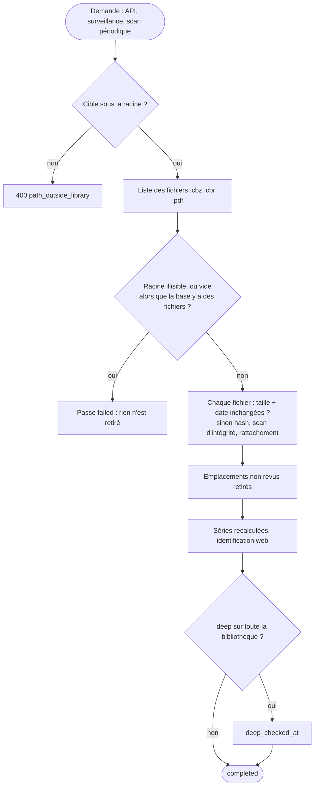
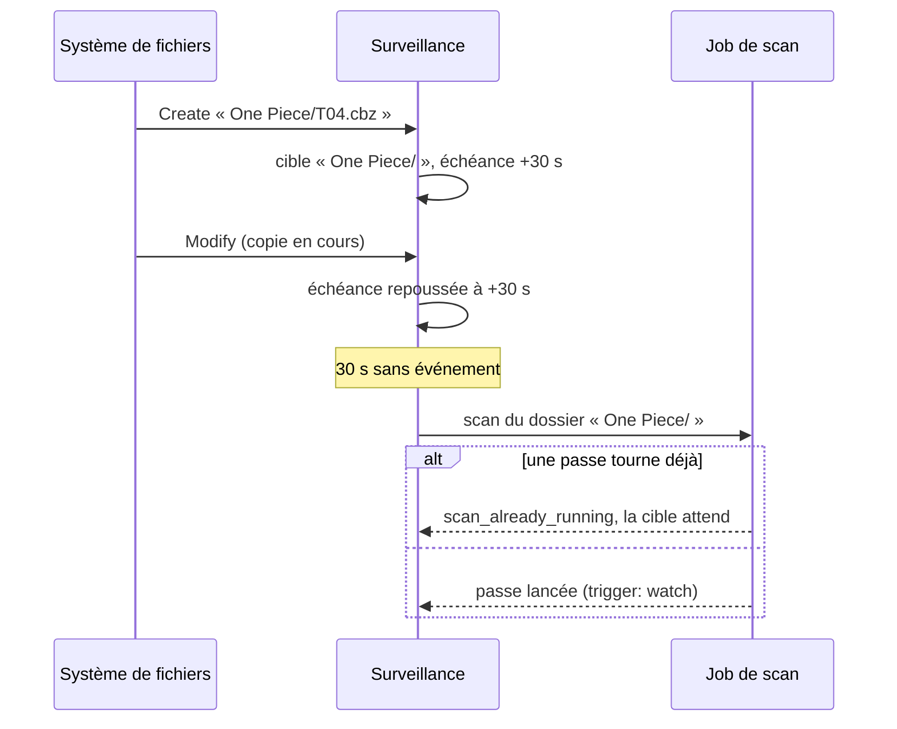
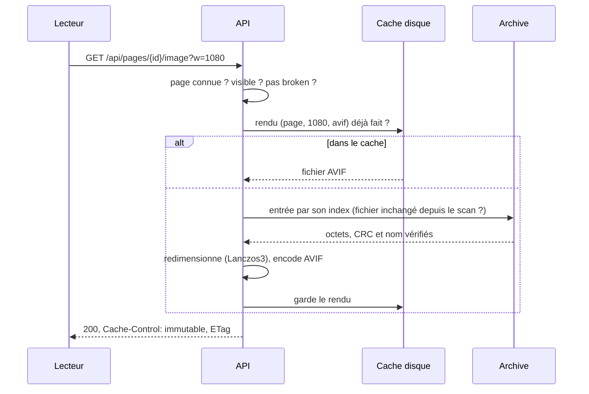

# Backend

## Serveur

- **axum** + **tokio**, boucle d'acceptation hyper avec un délai de 10 s pour recevoir les en-têtes (un client lent ne garde pas sa connexion), compression brotli / gzip des réponses texte, journaux `tracing` (`-v`, `-vv`, ou `RUST_LOG`).
- **État partagé** (`App`) : la base, le cache d'images, le job de scan, les métadonnées web, les sauvegardes, un sémaphore de rendus (4 au plus) et la garde d'authentification.
- **Arrêt propre** sur Ctrl-C et SIGTERM (`docker stop`) : plus aucune passe ne démarre, le scan en cours est annulé et sa passe close.
- **Front** : tout ce qui n'est pas `/api` est l'application web, un fichier de `web/dist`, ou `index.html` pour une route de l'application (React Router). En debug, `web/dist` est lu sur le disque ; en release, il est intégré au binaire (`rust-embed`) : `npm run build` avant `cargo build --release`.
- **Dossiers** : données et cache dans les dossiers de l'OS (crate `directories`), ou `SHIORI_DATA_DIR`, `SHIORI_CACHE_DIR`, `--db`, `--cache-dir`.

## Job de scan

`job.rs` : une passe à la fois, sur une bibliothèque, un dossier ou un fichier sous sa racine (sans `..` ni lien symbolique). Même moteur que la CLI (`Db::scan`), fichiers scannés en parallèle (`--jobs`), progression en mémoire, annulation entre deux fichiers. Une passe interrompue par un arrêt brutal est close (`interrupted`) au lancement suivant.

Fin d'une passe de dossier : les emplacements non revus sont retirés, sauf garde-fous :

- dossier illisible : la passe échoue sans rien retirer ;
- racine vide alors que la base y connaît des fichiers (disque démonté) : la passe échoue sans rien retirer ;
- sous-dossier illisible (`lost+found`) : ses tomes sont gardés tels quels, avec un avertissement.

Puis les séries sont recalculées (un dossier renommé garde son identité : la série est retrouvée par le hash de ses tomes), l'identification web part si elle est activée, et une passe `deep` terminée sur toute la bibliothèque note la date de vérification complète.

## Surveillance des dossiers

`watch.rs`, crate `notify` : un watcher récursif par bibliothèque surveillée.

- Un changement vise le **dossier de série** (premier niveau sous la racine) ; ce qui est posé, renommé ou retiré directement sous la racine, ou un dossier de série disparu, vise la racine (un renommage de série n'est reconnu que si une même passe voit les deux noms).
- **Temps calme** de 30 s par dossier : un fichier en copie relance l'attente. Les cibles attendent dans la surveillance (une par dossier) et partent une à une quand aucune passe ne tourne ; une passe de la racine couvre les dossiers en attente de sa bibliothèque.
- **Ignorés** : accès et métadonnées (le scan et le lecteur lisent les fichiers ; sinon, un scan en relancerait un autre), modification d'un dossier (Windows la signale en plus de celle de l'entrée), et ce que Shiori écrit lui-même (base, cache, sauvegardes rangés dans une bibliothèque), sous leur chemin et leur chemin réel (macOS signale `/private/var` pour `/var`).
- **Rattrapage** : une racine qui devient surveillée (démarrage, surveillance rétablie, disque monté plus tard) est scannée aussitôt, sauf une bibliothèque tout juste créée, dont l'interface lance déjà le scan.
- **Filet** : scan complet de toutes les bibliothèques toutes les `full_scan_hours` heures ; file d'événements débordée → rescan des racines ; racine impossible à surveiller → nouvel essai toutes les 5 minutes.
- Les passes notent leur origine (`trigger` : `manual`, `watch`, `schedule`).

## Images

- **Largeurs fixes** (`render.rs`, `WIDTHS` : 160, 320, 480, 640, 800, 1080, 1280, 1600, 2048 px) : le client demande la plus petite qui couvre sa largeur affichée en pixels réels ; une liste fermée borne le cache et empêche de faire calculer des milliers de variantes. Jamais d'agrandissement : une page plus étroite est servie telle quelle.
- **Formats** : AVIF pour les pages (`ravif`, qualité 70), JPEG pour les miniatures et les couvertures (qualité 85), redimensionnement Lanczos3, décodage plafonné en mémoire ; tout en Rust pur. Une page déjà en AVIF est servie telle quelle.
- **Cache disque** (`cache.rs`) indexé par (page, largeur, format, version du rendu) ; rien n'est jamais invalidé, le moins récemment lu part quand le plafond (`--cache-max-mib`, 2 Gio) est atteint. Au plus 4 rendus simultanés.
- **Rendu anticipé** : chaque page demandée par le lecteur (en AVIF ; pas une couverture en JPEG) fait préparer en arrière-plan les 5 pages lisibles suivantes du tome, à la même largeur et au même format, une à la fois ; seulement si un jeton de rendu reste libre pour les vraies demandes, et une vraie demande attend un rendu anticipé déjà en cours plutôt que de le refaire. Durée de chaque rendu dans les journaux (`RUST_LOG=shiori=debug`, message « page rendue »).
- **Webtoon** : les bandes sont servies en originale tant qu'elles ne dépassent pas trois fois la largeur utile.

## Métadonnées

Fusion **champ par champ** (`shiori-db::metadata`) : champ édité (verrouillé) > fichiers (`index.json`, puis `ComicInfo.xml`, puis `Info` d'un PDF) > sources web dans l'ordre choisi. La vue fusionnée d'une série est recalculée et stockée à chaque changement, une fois par langue de l'interface, chaque compte lisant celle de sa langue.

Sources web (`shiori-meta`, désactivées par défaut) : AniList (GraphQL), MangaDex (REST) et Wikipédia (API Action, résumé et lien seulement), appelées hors du runtime async, en série, débit sous les limites publiées, `Retry-After` et `maxlag` respectés, nom de client générique (pour Wikipédia, qui exige un contact : l'adresse du dépôt, jamais rien sur l'utilisateur), seul le titre de la série envoyé. Identification automatique après chaque scan : un lien seulement si un seul candidat a exactement le même titre normalisé. Couvertures téléchargées depuis les seuls hôtes connus de chaque source, sans suivre de redirection (parade SSRF), 4 096 px de côté au plus.

## Sauvegardes

`VACUUM INTO` (copie cohérente, Shiori allumé) dans un fichier temporaire caché, renommé une fois complet, droits 0600 sous Unix, nom `<préfixe>-AAAAMMJJ-HHMMSS.db`. Une base existante qui va être migrée est d'abord copiée (`shiori-avant-<migration>-…`). **Restauration** Shiori allumé : copie de travail vérifiée (`integrity_check`, table `_sqlx_migrations` présente), migrée au schéma courant (une version plus récente est refusée), schémas comparés, puis chaque table vidée et remplie en une transaction ; les sessions sont effacées.
