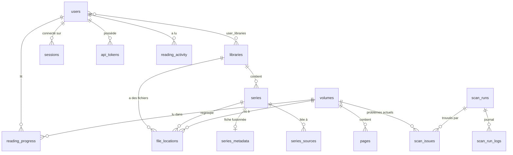

# Base de données

SQLite (`sqlx`, `sqlite-bundled`), un fichier `shiori.db` en mode WAL, migrations appliquées au lancement (`backend/crates/shiori-db/migrations/`, une par lot qui en a besoin). Une base existante est sauvegardée avant chaque migration.

## Tables

| Table | Contenu |
|---|---|
| `volumes` | un tome par contenu : hash, taille, format, statut, nombre de pages, version du scan, date |
| `pages` | une ligne par page : `page_id`, tome, nom d'entrée (décodé et brut), `ordinal`, index dans l'archive, type, largeur, hauteur, CRC, statut |
| `file_locations` | où se trouve chaque tome : chemin, taille, date, bibliothèque, série, résultat du parseur de noms, dernière passe qui l'a vu |
| `libraries` | bibliothèques : nom, racine, type, surveillance (`watch`), date de la dernière vérification complète (`deep_checked_at`) |
| `series` | séries : bibliothèque, dossier, nom, statut de publication, date d'ajout |
| `scan_runs`, `scan_issues`, `scan_run_logs` | passes de scan (statut, options, compteurs), problèmes actuels de chaque tome (ou d'un fichier illisible), journal de chaque passe (conservé `--scan-log-days`) |
| `users`, `sessions`, `user_libraries` | comptes (Argon2id, rôle), sessions (hash BLAKE3 du jeton, 90 jours glissants), bibliothèques ouvertes à un lecteur |
| `user_totp`, `user_recovery_codes` | secret TOTP d'un compte (dernier pas accepté), codes de secours (hash BLAKE3, usage unique) |
| `api_tokens` | jetons d'API (`shiori_t_` + 256 bits, seul le hash BLAKE3 gardé, préfixe, expiration facultative) |
| `reading_progress` | page lue par compte et par tome |
| `reading_activity` | pages, temps et tomes terminés par compte et par jour (statistiques) |
| `user_series_settings`, `user_settings` | réglages de lecture d'une série et préférences (langue, thème, sens des pages), par compte |
| `legacy_progress`, `legacy_series_settings` | progression et réglages d'avant les comptes, repris par le premier administrateur |
| `app_settings` | réglages de l'instance : langue, thème et sens des pages par défaut, métadonnées web, intervalle du scan complet (`full_scan_hours`) |
| `volume_metadata`, `volume_edits` | métadonnées des fichiers par tome, et champs édités à la main |
| `series_metadata` | champs édités d'une série et vue fusionnée, en français (`merged`) et en anglais (`merged_en`) |
| `series_sources` | fiches web liées ou candidates par série et par source |
| `covers` | couvertures des sources choisies (BLAKE3 du contenu) ; purgées au démarrage si plus aucune série ne les référence |

## Schéma simplifié

## Règles

- Ce qui dépend du chemin vit sur l'**emplacement** (`file_locations`), pas sur le tome : un même tome peut être vu à plusieurs endroits. Supprimer une bibliothèque supprime ses emplacements et ses séries, jamais les tomes ni les pages (la progression reste).
- `scan_issues` est l'**état courant** : les problèmes du dernier scan de chaque tome. Un fichier sans tome fiable (illisible) y a des lignes sans `volume_id`, nettoyées quand il disparaît.
- Une passe dont viennent les problèmes actuels d'un tome n'est pas purgée.
- Les dates sont en RFC 3339 UTC (`strftime('%Y-%m-%dT%H:%M:%fZ')`).
