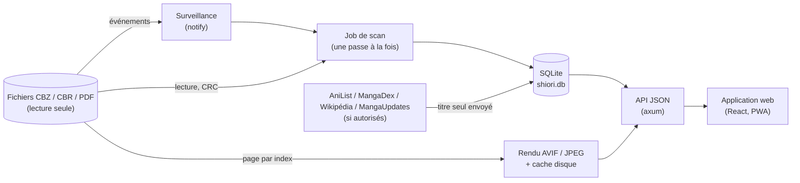

# Vue d'ensemble

Comment Shiori est construit, pour qui veut le maintenir ou y contribuer. Les décisions et leur historique sont dans [ROADMAP.md](https://github.com/befa160/shiori/blob/main/ROADMAP.md), les règles de travail dans [CLAUDE.md](https://github.com/befa160/shiori/blob/main/CLAUDE.md), l'interface dans [DESIGN_SYSTEM.md](https://github.com/befa160/shiori/blob/main/DESIGN_SYSTEM.md).

## Un seul binaire

Le binaire Rust `shiori` a quatre commandes :

- `shiori serve` (ou `shiori` sans argument) : serveur HTTP qui sert l'API JSON sous `/api` et l'application web (React) intégrée au binaire ;
- `shiori scan <chemins>` : scan d'intégrité en ligne de commande, avec ou sans base ;
- `shiori user …` : comptes, sans passer par le serveur ;
- `shiori backup` : sauvegarde de la base.

```
fichiers CBZ / CBR / PDF ──scan──▶ SQLite ──API JSON / images──▶ application web (PWA)
   (jamais modifiés)          (vérité)    (axum)                (React, service worker)
       ▲                                                           │
       └── surveillance des dossiers (notify) ─ scan ciblé         └── tomes hors ligne
```

Le scan est la seule source de vérité sur les pages : l'API et le lecteur ne font que relire ce qu'il a établi.



## Principes et invariants

- **Identité d'un tome** : BLAKE3 du contenu complet du fichier (`VolumeId`, `shiori-core/src/id.rs`). Renommer ou déplacer ne change rien ; modifier le contenu crée un nouveau tome. Hash complet au premier passage, puis taille + date de modification pour détecter un changement (`--rehash` force la relecture).
- **Identité d'une page** : `BLAKE3(volume_id ‖ 0x00 ‖ nom brut de l'entrée)`, tronqué à 128 bits (`PageId`), sur les octets bruts du nom dans l'archive (aucun décodage CP437 / UTF-8 ne peut changer un identifiant). Les deux formules sont figées par des tests `*_is_frozen` : les changer invaliderait toutes les adresses et toutes les progressions.
- **Ordre des pages** : tri naturel des noms d'entrées (`alphanumeric-sort`), stocké en `ordinal` ; à valeur égale, `9` précède `09`. L'ordre dans l'archive ne compte jamais : le lecteur reçoit la liste ordonnée des `page_id`, et le serveur lit chaque page par l'index enregistré pour cet identifiant (test « invariant de lecture » de bout en bout).
- **Adresses d'images immuables** : `/api/pages/{page_id}/image` répond avec `Cache-Control: immutable` et un ETag ; une page ne change jamais sous un même identifiant, donc aucun cache (navigateur, service worker, disque) n'a besoin d'être invalidé.
- **Erreur visible** : une page absente ou illisible renvoie une erreur JSON avec un code stable ; l'interface affiche cette erreur à la place de la page, jamais une autre image. Le service worker ne garde que les réponses 200.
- **Fichiers sources** : ouverts en lecture seule, jamais modifiés ni extraits en entier (sauf le cache borné des RAR solides).
- **Portabilité** : Rust pur autant que possible (SQLite embarqué, `ring` pour TLS), aucune commande externe, chemins indépendants du séparateur ; CI sous Linux, Windows et macOS.

## Le dépôt

```
backend/                   workspace cargo (toolchain stable, rust-toolchain.toml)
  crates/shiori-core/      archives (CBZ, CBR, PDF), identités, parseur de noms, scan d'intégrité,
                           ComicInfo / index.json / Info des PDF (sans base ni async)
  crates/shiori-db/        base SQLite (sqlx) : scans, bibliothèques, séries, progression, comptes,
                           réglages, métadonnées et leur fusion, santé ; migrations dans migrations/
  crates/shiori-meta/      clients AniList, MangaDex, Wikipédia et MangaUpdates (ureq + rustls), débit limité
  crates/shiori-testkit/   fixtures générées par du code (archives, images, cas tordus)
  crates/shiori/           le binaire : CLI, serveur axum, job de scan, surveillance des dossiers,
                           rendu des images, cache disque, métadonnées web, front embarqué
web/                       React 19 + TypeScript + Vite + Tailwind + shadcn/ui
  src/api/                 client et types de l'API, requêtes TanStack Query
  src/reader/              lecteur (pages, doubles pages, webtoon virtualisé, gestes, progression)
  src/library/ src/browse/ accueil, grilles, page série, modification, identification
  src/admin/               bibliothèques, santé, scans et journaux, comptes, métadonnées, données
  src/offline/             tomes téléchargés et progression hors ligne
  src/i18n/                catalogues fr.ts (source) et en.ts (typé sur le français)
  public/sw.js             service worker
  e2e/                     tests Playwright contre un vrai `shiori serve`
docs/                      cette documentation (VitePress)
```

## Choix de dépendances

| Besoin | Choix | Pourquoi |
|---|---|---|
| Serveur HTTP | axum, tokio, tower-http | standard de fait en Rust, léger, compression intégrée |
| Base | SQLite via sqlx (`sqlite-bundled`) | un fichier, rien à installer, requêtes vérifiées, migrations |
| ZIP | zip | zip64, accès direct par l'annuaire central |
| RAR | rars | Rust pur, RAR 4 et 5, solide compris (jamais `unrar`, non libre) |
| PDF | hayro-interpret (`embed-fonts`) | Rust pur, analyse paresseuse, décodeurs JPEG 2000, JBIG2, CCITT inclus |
| Hash | blake3 (`pure`) | rapide, sans code C |
| Images | image, ravif, imagesize | décodage et encodage AVIF / JPEG en Rust pur, dimensions sans décoder |
| Surveillance | notify | inotify, ReadDirectoryChangesW, FSEvents derrière une seule API |
| HTTP sortant | ureq + rustls (`ring`) | client synchrone simple, TLS sans OpenSSL |
| Mots de passe, TOTP | argon2, totp-rs, qrcode | Rust pur, QR en SVG sans image |
| Front embarqué | rust-embed | un seul binaire |
| Interface | React, Tailwind, shadcn/ui, TanStack Query | composants accessibles (Radix), état serveur simple |
| Documentation | VitePress | Markdown, recherche locale, deux langues |
