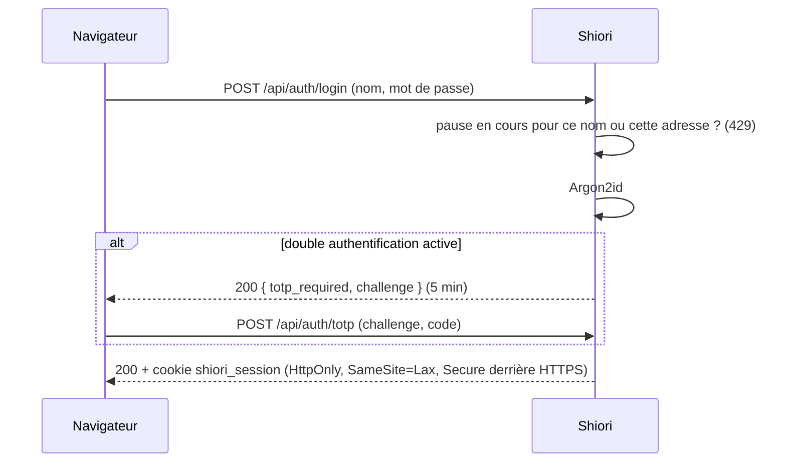

# Sécurité

## Authentification

- **Sessions** : jeton aléatoire de 256 bits, seul son hash BLAKE3 est gardé ; cookie `shiori_session` `HttpOnly`, `SameSite=Lax`, `Secure` quand le proxy annonce `X-Forwarded-Proto: https` ; 90 jours glissants. Une application native peut demander le jeton dans la réponse (`client: "app"`) et l'envoyer en `Authorization: Bearer`.
- **Mots de passe** : Argon2id, 8 caractères au moins, longueur plafonnée (un mot de passe de plusieurs Mo ne fait pas travailler Argon2 pour rien).
- **Essais ratés** comptés par nom depuis une adresse (5 libres) et par adresse (20 libres), puis pause qui double jusqu'à 15 minutes (429 `rate_limited`, `Retry-After`) sans calculer le hash ; et par nom toutes adresses confondues (50 libres, pause d'une minute au plus) : celui qui se trompe exprès sur votre nom ne vous bloque pas. L'adresse est celle de la connexion, ou le dernier `X-Forwarded-For` quand la connexion vient d'un reverse proxy : ceux de `--trusted-proxy` s'il y en a, sinon toute adresse locale (loopback ou réseau privé).
- **Installation** : tant qu'aucun compte n'existe, le premier administrateur se crée avec un jeton tiré au hasard à chaque démarrage et affiché dans la console (même avec `--quiet`).
- **Double authentification** : TOTP (`totp-rs`) SHA-1, 6 chiffres, 30 s, un pas de tolérance, un code ne sert qu'une fois ; défi de 5 minutes entre le mot de passe et le code ; 10 codes de secours (hash BLAKE3, usage unique).
- **Jetons d'API** : `shiori_t_` + 256 bits, seul le hash est gardé, expiration facultative, mot de passe exigé pour en créer un (il survit au changement de mot de passe) ; ils n'ouvrent que la lecture et la progression (403 `token_forbidden` ailleurs).
- **Mot de passe provisoire** : tant qu'il n'est pas changé, seules `/api/me` et `/api/me/password` répondent.

## Autorisations

Un lecteur ne voit que les bibliothèques qui lui sont ouvertes (404 pour le reste, sans dire qu'elles existent) ; les routes d'administration lui répondent 403 `forbidden`. Le dernier administrateur actif ne peut être ni rétrogradé, ni désactivé, ni supprimé.

## Parades

- **DNS rebinding** : en écoute locale, seul un `Host` local est accepté ; `--allowed-host` / `SHIORI_ALLOWED_HOSTS` ajoute des noms et active ce contrôle en écoute réseau (l'image Docker le fait pour `localhost`). Sinon : 403 `invalid_host`.
- **CSRF** : écritures refusées si `Sec-Fetch-Site: cross-site` (403 `cross_site`), en plus du cookie `SameSite=Lax`.
- **Chemins** : un scan ne vise qu'un chemin sous la racine d'une bibliothèque, sans `..` ni lien symbolique (`path_outside_library`).
- **Archives hostiles** : tailles déclarées vérifiées, plafonds d'entrées, de pixels et de mémoire, paniques des décodeurs isolées par fichier.
- **SSRF** : couvertures des sources téléchargées depuis leurs seuls hôtes connus, sans suivre de redirection.
- **Lenteur** : 10 s pour recevoir les en-têtes d'une requête.
- **Vie privée** : les sources web ne reçoivent que le titre d'une série, avec un nom de client générique.

## Signaler une faille

Ouvrez un [avis de sécurité privé](https://github.com/befa160/shiori/security/advisories/new) sur GitHub plutôt qu'un ticket public.
